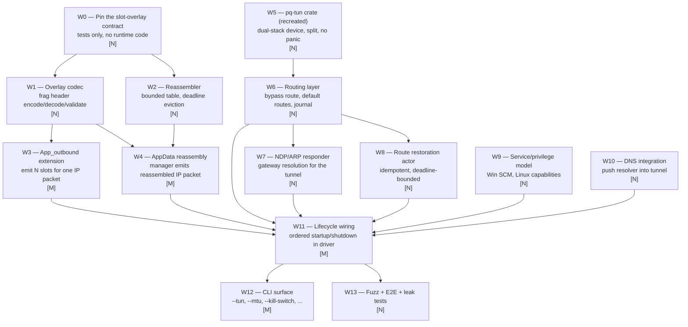

# D25 / D26 — System-Wide TUN Architecture: TUN Integration, Routing, Dual-Stack and Length Semantics

**Status:** PROPOSED (design review required — not implemented, not a decision of record)
**Author:** TRACK A design pass
**Date:** 2026-10-05
**Supersedes/scope:** Does **not** alter D19 (cover scheduling), D22 (metadata target is
reduction, not anonymity), D24 (data-path failure budget), or the fixed 1280-byte
`PACKET_SIZE` wire record.

> This document is a *proposal* for review. The `D25 —` / `D26 —` entries below are
> formatted to match `DESIGN_DECISIONS.md` (Status / Context / Decision /
> Consequences with Advantages + Tradeoffs) so they can be transplanted verbatim
> once approved. They are **not** yet in `DESIGN_DECISIONS.md`.

---

## 0. Product framing and scope guard

Tunnel is a **system-wide OS/networking tool**, not an application proxy. The
primary target is full-system VPN behaviour via OS-level integration (TUN device +
routes). Per-process masking / split tunneling is backlog only and is
deliberately excluded from this design.

D18 ("UDP Relay Client + Forwarding Backend") is **not** the product model. The
relay code is implementation infrastructure: it is the app-facing *ingress* for
the v0.2 datagram plane and remains useful as a diagnostic, a conformance harness
for the slot codec, and a fallback on platforms without a usable TUN. Nothing in
D25/D26 removes it.

### 0.1 Ground truth: what exists today (verified)

| Claim | Evidence |
|---|---|
| There is **no TUN code** in the tree. | `grep -ri "tun\b\|tun-addr\|tuntap\|utun\|wintun"` over `*.rs` returns only 8 lines, none of which create a device (`pq-tunnel-core/src/udp.rs:4`, `pq-tunnel-core/src/codec.rs:18,95-96`, `pq-tunnel-core/src/session_manager.rs:3448,3606` (a *test name* `adv_datapath_sequence_fuzz_10k`), `pq-tunnel-bin/src/packet_len.rs:5,12` (a **stale doc comment**)). |
| The current client driver drives a **local UDP relay socket**, not a TUN. | `pq-tunnel-bin/src/v2_client.rs:69-88` binds `--relay-listen`, refuses non-loopback, and calls `relay::run(...)` (`v2_client.rs:87`). The only `data_tx` producer is the relay loop. |
| The wire record is fixed 1280 bytes and must stay so. | `pq-tunnel-core/src/codec.rs:103` (`PACKET_SIZE = 1280`), `:133-139` (`HEADER_LEN`/`INNER_PLAINTEXT_LEN`/`PAYLOAD_LEN`), plus the compile-time partition asserts at `:143-151`. |
| `InnerPlaintext.payload` is a fixed `[u8; 1245]` with **no length field**; padding is implicit zero-fill. | `pq-tunnel-core/src/codec.rs:332` (`pub payload: [u8; PAYLOAD_LEN]`), `:363` (zero-init then copy), `:411-419` (`cover()` fills all 1245 bytes). |
| The AEAD enforces an exact-`PAYLOAD_LEN` plaintext contract. | `pq-tunnel-core/src/envelope.rs:261-268` rejects any payload whose length ≠ `PAYLOAD_LEN` with `CodecError::WrongLength`; `:272` builds `InnerPlaintext`; `:281-286` debug-asserts `INNER_PLAINTEXT_LEN + AEAD_TAG_LEN`. |
| Length recovery from a slot already exists and is the precedent. | `pq-tunnel-bin/src/packet_len.rs:13` `ip_packet_len()` — IPv4 total-length (bytes 2..4) or IPv6 payload-length (bytes 4..6) + 40; returns `0` on anything implausible and the caller drops (`packet_len.rs:10-12`). |
| `ip_packet_len()` currently has **no production caller**. | Only `packet_len.rs` tests and `fuzz/fuzz_targets/relay_overlay.rs:20,76`. `relay.rs` uses its own explicit `len` field instead (`relay.rs:13,135`). |
| SessionLimits defaults. | `session_manager.rs:136-148`: `max_sessions: 64`, `idle_timeout: Some(5 min)`, `lifetime_cap: None`, `liveness_timeout: Some(30 s)`, `handshake_timeout: Some(30 s)`, `fail_burst: 64`, `fail_window: 10 s`, `max_fail_buckets: 4096`. |
| Cover is armed only while the session is established/ready. | `session_manager.rs:1220-1230` (client: `manager.is_ready()`), `:1170-1172` (server: stops when `session_count() == 0`), `:1269-1270` / `:1320` / `:1337` (client stops on every `Closed`). |
| Rekey = close + re-establish (no in-place rekey). | `wire_session.rs:22-32` module docs; `wire_session.rs:224-227` and `:262-265` transition to `Rekey` and return `RekeyRequired`; `session_manager.rs:163` `CloseReason::NonceExhausted`. |

### 0.2 The deleted TUN implementation (M4, commit `b012b7e`)

**What existed.** A dedicated workspace crate `pq-tun` (deleted) wrapping the
`tun` crate v0.7 with the `async` feature:

```rust
// pq-tun/src/lib.rs @ b012b7e^
pub struct TunDevice { device: tun::AsyncDevice }
impl TunDevice {
    pub fn create(name: &str, addr: IpAddr, netmask: IpAddr, mtu: u16) -> Result<Self, TunError> {
        let mut config = tun::Configuration::default();
        config.tun_name(name).address(addr).netmask(netmask).mtu(mtu).up();
        #[cfg(target_os = "linux")]
        config.platform_config(|pc| { pc.ensure_root_privileges(true); });
        let dev = tun::create_as_async(&config)...;
```

plus `split() -> (TunReader, TunWriter)` with `AsyncReadExt`/`AsyncWriteExt`
wrappers, and a `TunError { Device, Io, NotConfigured }` enum.

The consumer was `run_tunnel_mode` in `pq-tunnel-bin/src/quic.rs` (deleted).
Its entire data path was: `reader.read_packet(&mut [u8; 2048])` →
`send_data_packet(&send1, &buf[..n])` inbound, and
`recv_data_packet(&mut recv2)` → `writer.write_packet(&data)` outbound, with a
hardcoded `cover_rate = 100u64` loop emitted **only when a TUN read returned 0**.

The CLI surface removed with it: `--tun-addr` (default `10.0.0.1/24`), `--mtu`
(default `1400`), plus a hand-rolled `parse_tun_addr()` CIDR parser with tests.

**Why it was deleted.** D20 records the rationale: the whole pre-v2 QUIC/TLS
stack was removed because it performed **no server-certificate validation**,
used self-signed certs and unrestrained `HybridIdentity` XOR-combiner
derivation, and shipped a *different* (8192-byte) framing. `pq-tun` was deleted
as a **v1-only workspace member** ("`pq-tun` deleted; `pq-proxy` excluded from the
workspace") — it was collateral of removing the QUIC transport, **not** a
judgement that TUN is wrong.

**Why almost none of it is reusable.**

1. **Wrong wire format.** The removed tunnel used `send_data_packet` over a QUIC
   *stream* with an 8192-byte framing — byte-incompatible with the 1280-byte
   codec (D20). Everything about its packet handling is void.
2. **Wrong cover model.** Its cover was `100u64` pkt/s **hardcoded in the client**
   and fired only on a `Ok(0)` read — exactly the D19 violation ("cover is a
   transport behaviour, never negotiated", default fixed 2 Mbps = 195.3 pkt/s,
   emitted while ESTABLISHED *including when idle*). Reusing that loop would
   silently regress D19.
3. **Wrong length semantics.** It forwarded `&buf[..n]` from a 2048-byte buffer
   with no notion of `ip_packet_len()` — under the fixed slot it would write
   trailing garbage into the TUN.
4. **No routing, no dual-stack, no DNS, no privilege model, no restore.** The
   `tun` crate's `Configuration` sets address/netmask/MTU and `up()`; nothing
   installs routes, nothing is undone on exit. A crashed process leaves a broken
   default route on the host.
5. **`split()` panics on failure** — `Err(e) => panic!("split must succeed: {}", e)`,
   violating AGENTS.md "Fail Securely" (Charter §11).

**Verdict: ~0 % reusable.** The only transferable knowledge is *which crate
approach* (`tun` 0.7 + async feature works on Windows and Linux, and
`ensure_root_privileges` is the Linux hook). That decision must be re-made
against the current crate state, not inherited — see Open Question **Q3**.

The one genuine artefact is `pq-tunnel-bin/src/packet_len.rs:5,12`, whose doc
comment ("the client's slot → TUN write") survives from a TUN-aware design that
never landed. It documents the intended contract and is already fuzz-covered
(`fuzz/fuzz_targets/relay_overlay.rs:76-89`). **This is the single strongest
reuse signal in the tree.**

---

## 1. D25 — Fragmented TUN Data Plane with Recoverable Routes

## Status

Proposed (design review required; supersedes nothing; D18 remains the v0.2
product path until D25 lands)

## Context

The product goal is full-system VPN behaviour. That requires capturing OS IP
packets with a TUN device, routing them into the tunnel, and writing decapsulated
packets back. Three structural facts of the existing system constrain the design.

**Fact 1 — the slot is fixed and there is no length field.** Every Tunnel
datagram is exactly `PACKET_SIZE = 1280` bytes
(`pq-tunnel-core/src/codec.rs:103`). Inside the AEAD sits an `InnerPlaintext` of
`msg_type(1) ‖ direction(1) ‖ payload[1245]`
(`codec.rs:137-139`, `:376-379`). The payload array is a fixed `[u8; 1245]`
(`codec.rs:332`) with implicit zero-fill; `envelope.rs:261-268` rejects anything
that is not exactly 1245 bytes. A standard 1500-byte-MTU IPv4 packet plus a
TUN/UDP/IPv6 outer header does **not** fit in 1245 bytes. Fragmentation is
therefore not optional; it is forced.

**Fact 2 — the wire format is byte-pinned.** `codec.rs:103` and the
compile-time partition asserts (`codec.rs:143-151`) mean `PACKET_SIZE` cannot
change without a protocol version bump (`PROTOCOL_VERSION`, `codec.rs:83`) and a
D13-scale change. The task constraint is therefore: fragment **inside** the slot,
never across datagram sizes.

**Fact 3 — traffic is additive over cover, and slot count is observable.** D22
is explicit: app data is emitted **additively on top of** the per-session cover
grid, and the target is metadata *reduction*, not traffic-flow anonymity. D19
cover is a fixed constant 2 Mbps (5.12 ms per 1280-byte slot ≈ 195.3 pkt/s,
`scheduler.rs:36`, `:57-59`, `:161-167`) emitted while the session is
established *including when idle*. So the length of a data burst, in slots and
in time, is **already** on the wire and **already** a D22-accepted observable.
Fragmentation therefore does not create a *new class* of leakage — but it does
change the *shape* of what is observable, and the shape must be chosen
deliberately rather than inherited from "whatever the split logic does".

The status quo answer to all of this is: **nothing**. There is no TUN code (§0.1),
and `ip_packet_len()` — written for exactly this purpose — has no production
caller.

## Decision

### 1.1 Length semantics: tunnel-layer fragmentation with a 4-byte in-slot header (RECOMMENDED)

Define, **inside** the encrypted `PAYLOAD_LEN` slot, a data-plane overlay header:

```text
InnerPlaintext (Data):
  msg_type(1)=0x01 ‖ direction(1) ‖
  hdr_ver(1)=0x01 ‖ frag_idx(1) ‖ frag_total(1) ‖ frag_flags(1) ‖
  packet[0 .. 1245-4 = 1241]

frag_idx: zero-based, < frag_total
frag_total: total slots for this datagram, >= 1
frag_flags: bit0 = MORE (more fragments follow), bit1 = FIRST (idx 0)
            bits 2..7 reserved, MUST be 0
```

- **Effective payload per slot = 1241 bytes.** A 1245-byte IPv4 packet now
  requires 2 slots (was 1), but *every* packet still costs at least one slot.
- **Reassembly key = `(session_id, packet_nonce-of-FIRST, direction)`.** Every
  fragment of one packet is emitted back-to-back on the same `WireSession`, so
  the session's monotonically increasing `packet_nonce` (`envelope.rs:293-299`)
  already orders them. The receiver takes the FIRST fragment's header nonce and
  assembles the following `frag_total - 1` fragments.
- **Failure mode is fail-secure and uniform:** any missing/duplicate/reordered
  fragment causes the whole datagram to be **silently dropped** (PROTOCOL_SPEC
  §14) after a bounded deadline. There is no NAK, no retransmit, no partial
  write to the TUN. A partial write is impossible by construction because
  reassembly only ever hands a *complete* buffer to the TUN writer.
- **The 4 bytes are inside the AEAD ciphertext**, so the wire record is
  unchanged and `ciphertext()` / `tag()` offsets (`codec.rs:492-511`) are
  untouched. See §3 for the full invariant analysis.

**Why this does not leak, precisely.** The `frag_idx`/`frag_total` bytes are
ciphertext, not cleartext — a passive observer sees only `PACKET_SIZE` bytes with
a stable 17-byte cleartext header. But the *number of consecutive datagrams*
carrying one packet is observable, and it correlates with packet size. Three
mitigations, in order of importance:

1. **D22 already accepts additive volume as observable.** Slot count per burst is
   exactly the "traffic volume" residual D22 records as accepted-by-design. We
   are not introducing a new observable class; we are choosing the encoding of
   one that D22 already accepts.
2. **Fragment count is bounded and pinned.** With a 1241-byte payload, a
   maximum-size IP packet (65535 bytes IPv4) needs 53 slots — so `frag_total` has
   a small, enumerable domain. Bounding it is also required for the reassembly
   buffer cap.
3. **Explicitly documented, not hidden.** This decision names the residual in
   `THREAT_MODEL.md` so the guarantee stated is exactly the guarantee delivered
   (Charter §14, "No Hidden Behaviour").

The alternative considered — a **fixed number of slots per packet** — makes
`frag_total` a compile-time constant, so length is *not* variable at the slot
count level. It is rejected because it multiplies fixed bandwidth by the
worst-case factor: at 2 slots/packet a 60-byte ARP reply and a 1245-byte
fragment both cost 2 × 1280 bytes, roughly tripling the fixed floor and
halving effective throughput for no gain that D22 does not already concede.

### 1.2 MTU and fragmentation budget

- **TUN MTU is a *local* parameter, not a negotiated one.** Nothing about MTU
  crosses the handshake (PROTOCOL_SPEC §7.5: the transport SHOULD NOT depend on
  "specific MTU sizes"; D19: cover is never negotiated). Both peers derive the
  slot capacity from the constant `PAYLOAD_LEN`, so they agree by construction.
- **Client-side effective IP MTU = 1241 bytes** (payload after the 4-byte
  overlay header). Set the TUN device MTU to **1241** for IPv4 and **1201** for
  IPv6 (40-byte IPv6 header vs 20-byte IPv4 → 1241 - 20 = 1221 to keep the
  *IP-layer* packet ≤ 1241 including its header; see the arithmetic below).
  - Precisely: an IP packet must be ≤ 1241 bytes including its own header. A
    1241-byte IPv4 packet = 20 (hdr) + 1221 (payload) = 1 slot. A 1241-byte
    IPv6 packet = 40 (hdr) + 1201 (payload) = 1 slot. So **TUN MTU = 1241 for
    both families**; the IPv6 inner payload capacity is smaller because the
    header is larger, which is exactly what a real MTU of 1241 means.
- **TCP MSS:** with MTU 1241 and a 20-byte IPv4 header and 20-byte TCP header,
  MSS = 1201. OS stacks derive this automatically from the interface MTU; we do
  not clamp sockets. This is why the "reject oversize / ICMP" option (§1.3
  option C) is specifically bad — it breaks this negotiation.
- **The outer path is unconstrained by us but must be checked.** Each slot is a
  1280-byte UDP payload; encapsulated with IPv6 (40) + UDP (8) that is 1328 bytes
  on the wire. This exceeds a 1500-byte-MTU path with headroom but fits (1500 -
  20 IPv4 - 8 UDP = 1472 available; 1280 fits comfortably). We must **not** emit
  1280-byte UDP payloads over a path whose MTU is unknown/1280-only without
  IP-level DF handling. This is a **route-quality constraint, not a tunnel
  constraint**, and is out of scope for the first TUN milestone — see **Q5**.

### 1.3 Options analysed (as required)

| Option | Mechanism | Verdict |
|---|---|---|
| **A. IP-layer fragmentation before tunnel ingress** | Host does IPv4 DF-off fragmentation into ≤ MTU datagrams; each becomes one slot. | **Rejected.** (i) IPv6 does **not** fragment at the source — RFC 8200 requires the *router* to fragment and forbids source fragmentation; a host cannot pre-fragment IPv6, so this option is IPv4-only and silently breaks dual-stack. (ii) Reassembly is the OS's job, and the tunnel becomes a single-hop path that must *never* fragment (it must set DF), which conflicts with the TUN's own job. (iii) It leaks length by fragment count identically to option B, with none of B's determinism guarantees. |
| **B. Tunnel-layer fragmentation with an in-slot header** (RECOMMENDED) | 4-byte overlay header inside the AEAD; reassembly by `(session, first-fragment nonce)`. | **Accepted.** Works identically for v4/v6. Header is authenticated (it is ciphertext, covered by the AEAD tag). Length is recoverable **without** `ip_packet_len()` for the single-slot case and *with* explicit indices for the multi-slot case, which is strictly more robust than parsing a variable-offset IP header. Fully implementable with no protocol change. |
| **C. Reject oversize, send ICMP/PTB** | Packets > 1245 dropped; inject ICMP Destination Unreachable / Packet Too Big into the TUN so the host shrinks its packets. | **Rejected as the primary mechanism.** It is a *valid complement* (retain it as the guard for the 53-slot overflow case, §1.5) but as a primary mechanism it (i) breaks TCP MSS negotiation on the first oversize packet, which is exactly the reliability trap named in the brief; (ii) for IPv6 the correct response is ICMPv6 Packet Too Big back to the *host*, which the host must then honour — an interaction with the OS stack that we do not control; (iii) drops are silent from the tunnel's perspective (PROTOCOL_SPEC §14), so the host learns only via ICMP that we must synthesise, which is a new error-feedback surface D18 explicitly deferred ("no ICMP / unreachable feedback in v0.2", D18 Tradeoffs). |
| **D. Fixed N slots per packet** | Every packet costs exactly N × 1280 bytes. | **Rejected.** Removes the slot-count/length correlation entirely (a genuine property), but costs ~2× fixed bandwidth on every packet including 60-byte ARP/ACK. Because D22 already concedes volume as an observable, this property is not worth a 2× floor. **Retained as the fallback if a future milestone ever adopts the absorbing emission model D22 declined** — the two fit together, and this document records the coupling. |

### 1.4 Routing (default-route hijack, restoration, loop avoidance)

**Loop avoidance is structural and comes free.** The rule is: *the tunnel's own
outer UDP socket must be exempt from the tunnel.* Concretely, on both platforms,
the route to the tunnel server's address must be the most specific route in the
table and must resolve to the physical interface, not the TUN. Implementation:

- **Windows:** pin a high-metric (i.e. low-preference) default route through the
  TUN, and add an explicit /32 (v4) or /128 (v6) host route to the server address
  through the physical interface with a *lower* metric. Windows route selection
  is longest-prefix-first, so the /32 wins regardless of metric. Additionally,
  bind the outer `UdpTransport` socket with `SO_BINDTODEVICE`-equivalent
  behaviour where available, or rely on the /32 host route alone (recommended:
  the /32 is the portable, auditable mechanism).
- **Linux:** `ip route add default dev <tun> table 100` + `ip rule add not
  from <tun-addr> lookup 100` style policy routing, plus an explicit
  `ip route add <server-ip>/32 dev <physical>` in the main table. Policy routing
  avoids the classic "route to server goes into tunnel" loop. Alternative (and
  simpler): rely on `SO_BINDTODEVICE` on the outer socket.
- **Socket binding must not regress.** `UdpTransport::connect` deliberately
  leaves the socket **unconnected** so `set_peer` can roam (`udp.rs:90-97`). Any
  routing work must preserve that property; do not "fix" the loop by
  kernel-connecting the socket.

**Route restoration on shutdown.** The client must record every route it
installed (interface index, destination prefix, metric, next-hop, and the
OS-specific tag) **before** installing it, and restore in reverse order on
shutdown. Restoration must run on **every** exit path: normal `Drop`, `Ctrl-C`
(SIGINT), SIGTERM, and the Windows Service stop path. Restoration must be
idempotent, because a crash-loop will re-enter it. If a recorded route is already
gone, removal is a no-op success, not an error.

**Fail-secure on partial installation.** If route installation fails *after* the
TUN is up, the client must tear down everything installed so far and return an
error — never leave a half-hijacked default route. This is Charter §11 (Fail
Securely) applied to the network stack.

**Kill-switch.** A `--kill-switch` that installs a reject-all route and does *not*
establish a tunnel is the single most important safety valve for a full-system
VPN: it must guarantee no traffic escapes. This is a **documented reduction**
(observable: no session exists, no cover flows) and must be opt-in and loudly
documented per Charter §12.

### 1.5 Bounds (fail-secure, not fail-open)

Every buffer the new path introduces is capped, and every cap is a *drop*, never
a grow:

- **Max slots per datagram: 53** (65535 / 1241, rounded up). A `frag_total` > 53
  is a protocol violation → silent drop.
- **Reassembly table: 256 in-flight datagrams per session**, oldest evicted.
- **Reassembly deadline: 2 × cover interval** (≈ 10.24 ms at default). An
  incomplete datagram at deadline is dropped.
- **Reassembly buffer: 53 × 1241 = 65,773 bytes maximum** per in-flight entry.
  With 256 entries this is a 16 MiB ceiling; it must be a *global* cap, not
  per-entry-only.
- **Oversize guard:** an IP packet whose header declares a length > 53 × 1241 is
  rejected **before** any buffering, and an ICMP is synthesised (option C as a
  complement). This is the one place C earns its keep.

### 1.6 Packet framing — mapping raw IP onto the protocol

| Layer | Format | Notes |
|---|---|---|
| TUN read | raw IP packet, 0..65535 bytes, version nibble 4 or 6 | length from the TUN read count `n` |
| Overlay (in-slot) | `hdr_ver(1) ‖ frag_idx(1) ‖ frag_total(1) ‖ frag_flags(1) ‖ ip[..]` | 4-byte header, then up to 1241 bytes |
| `InnerPlaintext` | `msg_type(1)=Data ‖ direction(1) ‖ overlay` | `codec.rs:376-379` |
| `WirePacket` | `version(1) ‖ sid(8) ‖ nonce(8) ‖ AEAD(1247) ‖ tag(16)` = 1280 | `codec.rs:133-139` |

**Backwards compatibility.** `MessageType::Cover` (`codec.rs:190`) and the
handshake fragments (`hs_type` 0x10/0x20/0x30, dispatched by byte 9,
`handshake_v2.rs:284-289`) are **untouched**. `MessageType::Data` gains an
overlay meaning that did not previously exist — but nothing in the current tree
produces `Data` frames with a body that is not already a relay frame
(`relay.rs:13`) or an opaque app payload (`v2_client.rs:57`, the `data_tx`
channel). **The overlay is a new in-slot convention, not a wire change.** A
`PROTOCOL_VERSION` bump is **not** required for the 1280-byte record itself, but
**is** required before any peer must distinguish overlay from legacy `Data`
payloads — see **Q1**.

**Forward/backward interop with the D18 relay.** The relay framing
(`family ‖ addr ‖ port ‖ len ‖ datagram`, `relay.rs:5-8`) already carries an
explicit `len` and is confined to `relay.rs` / `forward.rs`. The TUN overlay
carries a raw IP packet and recovers length from the IP header or from
`frag_total`. **These are two different in-slot conventions.** They must be
distinguished by `hdr_ver` (0x01 = TUN overlay; the relay frame is
self-identifying by its `family` byte at payload[0], which can never be 0x01 or
0x04/0x06 in a TUN overlay slot because `hdr_ver` occupies that byte). This
disjointness must be **pinned by a test**, not assumed.

### 1.7 Interaction with `ip_packet_len()` — VERIFIED ANSWERS

**Q: Does adding an in-slot fragmentation header break `ip_packet_len()`?**

**A: Yes, for the multi-slot case; no, for the single-slot case.** Concretely:

- `ip_packet_len()` (`packet_len.rs:13`) is called with `&inner.payload` — the
  **whole 1245-byte slot**, zero-padded. With the overlay, `payload[0]` is
  `hdr_ver` (0x01), not the IP version nibble. `payload[0] >> 4 == 0` →
  the function returns `0` (`packet_len.rs:38`, the `_ => 0` arm). **Every
  overlay slot fails the existing parser.**
- The fix is a one-line offset at the call site, *not* a change to the function:
  pass `&payload[4..]` (skip the 4-byte overlay header). For a single-slot
  packet, `ip_packet_len(&payload[4..])` then reads the IPv4 total-length at
  `payload[4+2..4+4]` or the IPv6 payload-length at `payload[4+4..4+6]` exactly
  as it does today.
- **For `frag_total > 1` the existing function is not merely misaligned, it is
  insufficient**: it can only report the length of *one* slot's worth of bytes
  and cannot know that bytes are split across slots. Multi-slot reassembly must
  use `frag_total` (a protocol field, authenticated by the AEAD) as the
  authoritative datagram length — which is **more trustworthy** than parsing a
  length field out of a header, because it is authenticated rather than merely
  structurally validated.
- Therefore: `ip_packet_len()` is **retained as the single-slot validator** (it
  still performs the `>= 20` / `<= slot` sanity checks that `packet_len.rs:22-27`
  and `:30-35` provide, and those checks remain valuable against a hostile peer
  that lies about `frag_total`), and the reassembler uses `frag_total` for
  multi-slot datagrams. Both are cross-checked: for `frag_total == 1`, the
  reassembler **must** verify `ip_packet_len(&payload[4..]) == 1241 - something`
  is consistent, and drop on disagreement.

**Q: Does it interact with the AEAD-ciphertext-length invariant in `codec.rs`?**

**A: No. The invariant is untouched, because the overlay header is *inside* the
plaintext, not a change to its size.** Verified:

- `INNER_PLAINTEXT_LEN = PACKET_SIZE - HEADER_LEN - AEAD_TAG_LEN = 1247`
  (`codec.rs:135`), enforced by the compile-time assert `HEADER_LEN +
  INNER_PLAINTEXT_LEN + AEAD_TAG_LEN == PACKET_SIZE` (`codec.rs:143-148`).
- `PAYLOAD_LEN = INNER_PLAINTEXT_LEN - 2 = 1245` (`codec.rs:139`), asserted at
  `:149-151` (`INNER_PLAINTEXT_LEN > 2`).
- `envelope.rs:261-268` requires the payload to be **exactly** `PAYLOAD_LEN`
  before constructing `InnerPlaintext`. The overlay fills exactly 1245 bytes
  (4 header + 1241 data, zero-padded for the tail). ✓
- `envelope.rs:281-286` debug-asserts `ciphertext.len() == INNER_PLAINTEXT_LEN +
  AEAD_TAG_LEN`. Unchanged — AEAD output length is a function of *plaintext*
  length, and the plaintext length did not change. ✓
- `envelope.rs:272` `InnerPlaintext::new(msg_type, direction, payload)` →
  `codec.rs:363` copies into a `[0u8; PAYLOAD_LEN]` — the overlay's zero-padded
  tail is preserved exactly as the implicit zero-fill the slot already had.
- `WirePacket::ciphertext()` / `tag()` (`codec.rs:492-511`) slice on
  `HEADER_LEN` and `INNER_PLAINTEXT_LEN`, both unchanged.
- **Net effect: the fragmentation header consumes 4 bytes of the 1245-byte
  payload.** `PAYLOAD_LEN` (the constant) does not change. What changes is the
  *usable* per-slot IP capacity, from 1245 to 1241 — a property of the overlay,
  not of the codec.

### 1.8 IPv4/IPv6 dual-stack — the critical leak trap

**The trap:** a full-system tunnel that captures only IPv4 leaves IPv6 traffic
flowing **directly to the network**, outside the tunnel. This is the single most
damaging failure mode of this milestone and it is a *security* failure, not a
correctness one.

Requirements:

1. **The TUN must be configured dual-stack by default.** Both an IPv4 and an
   IPv6 address on the device, both `::/0` and `0.0.0.0/0` default routes.
   `pq-tun`'s deleted `create(name, addr, netmask, mtu)` took a *single*
   `IpAddr` (`b012b7e^:pq-tun/src/lib.rs`) and could not express dual-stack —
   another concrete reason it is not reusable.
2. **IPv6 leak prevention must be fail-secure.** If the IPv6 half of the tunnel
   cannot be brought up (no IPv6 support in the `tun` crate build, route install
   fails, the peer is unreachable), the client must **refuse to bring the tunnel
   up at all** rather than bring up a v4-only tunnel. A v4-only "full-system"
   tunnel is an insecure default and violates Charter §9 (Secure by Default).
3. **An explicit `--no-ipv6` escape hatch** may exist, but it is a **documented,
   visible reduction** (Charter §12) that must log a warning at startup and must
   be reflected in `--help` text, not buried. And it must be **incompatible with
   the "full-system" claim in the log line** — the client should say "IPv4 only,
   IPv6 traffic is NOT tunnelled" rather than "tunnel up".
4. **IPv6 fragmentation caveat.** Because we fragment at the tunnel layer
   (option B), we never set DF and never ask the host to fragment — which is
   correct for IPv6, where source fragmentation is forbidden. This is a genuine
   advantage of option B over option A and is called out here deliberately.
5. **IPv6 link-local, multicast, and neighbour discovery** traffic that the TUN
   presents (RA, DHCPv6, NDP) must be handled or explicitly dropped. NDP
   solicited-NS for the tunnel's own gateway must be answered, or every outbound
   packet will queue in ARP/NDP resolution and stall. This is the #1 practical
   TUN bug and must be a named work item (see **W7**).

### 1.9 Privilege / service model

- **Windows:** a Service is required. Creating a Wintun adapter and installing
  default routes requires Administrator. Design: `pq-tunnel service install|run|stop`
  plus a client control channel. The identity material
  (`--identity` PQTI file) must be readable **only** by the service account —
  per AGENTS.md Git Hygiene and Charter §16 ("no protection against physical
  device security", but credentials are explicitly out of git).
- **Linux:** `CAP_NET_ADMIN` is required. Options are (i) run as root, (ii) a
  `systemd` unit with `AmbientCapabilities=CAP_NET_ADMIN`, or (iii) a
  polkit-gated unprivileged path. The deleted `pq-tun` used
  `pc.ensure_root_privileges(true)` which is a *test-mode* helper, **not** a
  privilege model — it must not be reused as one.
- **Least privilege in both cases:** the tunnel process should hold only
  `CAP_NET_ADMIN` (Linux) / service-logon + admin (Windows), **never** run as a
  general-purpose privileged daemon, and must not be reachable by unprivileged
  local processes in a way that lets them reconfigure routes.
- **Identity handling:** `identity::load_identity` (`v2_client.rs:47`) currently
  runs in the same process as the socket. With a service split, key material
  stays in the service; the client control channel carries only route/state
  commands, never keys.

### 1.10 DNS path

**DNS is a separate leak vector and is in scope for the milestone.** If the
system resolver still queries the ISP while HTTP is tunnelled, the leak is
total (DNS alone identifies the user).

- **Push DNS into the tunnel.** Configure the OS resolver to a resolver that is
  itself reachable only through the tunnel (e.g. a resolver on the tunnel's
  virtual subnet), so resolver queries traverse the same path.
- **The resolver must speak inside the TUN data plane.** Because the TUN carries
  raw IP, a UDP/53 query to the tunnel-side resolver is just another IP packet —
  it needs **no new wire format and no new `MessageType`**. This is a large
  simplification enabled by the TUN design and must be stated explicitly.
- **Reconfiguration must be reversible and must fail securely.** If DNS
  reconfiguration fails partway (Windows `GetAdaptersAddresses`/registry
  rollback, Linux `/etc/resolv.conf` or `resolvectl` revert), the tunnel must
  either complete reconfiguration or restore the prior state — never leave the
  host with no resolver or with a resolver pointing at an unreachable tunnel
  address.
- **Do not silently write `/etc/resolv.conf`** on Linux without an explicit opt-in
  and a backup/restore; it is a shared, often-managed file. Prefer
  `resolvectl`/resolved integration.
- **Open question:** whether Tunnel ships its own caching resolver or merely
  redirects the system resolver. Shipping one is a larger attack surface; see
  **Q6**.

### 1.11 Lifecycle, startup and shutdown

Startup order (each step's failure must unwind all prior steps):

1. Load and validate identity + pinned server key (fail closed —
   `v2_client.rs:43-47`).
2. Create the TUN device (dual-stack).
3. Install the bypass/host route to the server address (**before** the default
   route, so the tunnel socket never captures itself).
4. Install default routes v4 and v6 through the TUN.
5. Record every installed route in a restore journal (in memory; flushed to a
   small state file if crash-restore is wanted).
6. Start the session manager and begin the handshake
   (`session_manager.rs:773` `begin_handshake`).
7. Only on `ManagerNotification::Ready` (`session_manager.rs:228`, `:1226`)
   enable the TUN *forwarding* direction and reconfigure DNS.

Shutdown order (reverse, and on every path):

1. Stop accepting new TUN reads; drain in-flight reassembly entries.
2. Restore DNS to its pre-tunnel state.
3. Remove default routes (reverse of install order).
4. Remove the bypass host route.
5. Close the session (fire-and-forget `Close`, `session_manager.rs:977-995`).
6. Delete/close the TUN device.

**Crash behaviour.** A process crash leaves the routes installed. Windows: the
Service Control Manager stops dependent services; the TUN adapter removal on
process exit restores routing. Linux: a crash leaves `ip rule`/`ip route` entries
that **must** be cleaned by the next start (idempotent reconcile, not blind
install). Make startup a *reconcile*: adopt-and-replace, never accumulate.

**Interaction with D16 re-establishment.** When the session closes and
re-establishes (`session_manager.rs:1266-1274`), the **routes and the TUN stay
up**. Only the crypto session is rebuilt. This is correct and important: tearing
down the TUN on every session churn would flap the host's network and emit a
lifecycle fingerprint on every rekey. Note the consequence for D19 below.

### 1.12 Cover traffic while the TUN is idle (the D19 consistency question)

**Question posed:** if the TUN device is up but no traffic flows, does that emit
cover? Is that consistent with D19? Should the client ever bring the TUN link
down and lose the pattern?

**Answers:**

1. **Yes, cover continues.** The cover arm is driven by `CoverScheduler` inside
   `run_client_manager` (`session_manager.rs:1346-1369`) and is armed only on
   `is_ready` (`:1221-1229`). It is **completely decoupled from the TUN**. A TUN
   device that is up but silent emits cover at the full 2 Mbps grid, exactly as
   D19 requires ("an established idle session keeps emitting", D19 Decision
   bullet 3). This is already true in code today; TUN does not change it.

2. **This is consistent with D19 and with D22.** D19 says cover is a *transport*
   property of an established session. D22 says the residual channel is
   "activity above the floor" — i.e. the floor exists precisely so that *idle*
   and *busy* sessions look the same at the base rate. A TUN that stopped cover
   when idle would invert that: idle would become *distinguishable*, which is
   strictly worse than D22 concedes.

3. **The client must never bring the TUN link down on idle.** Bringing the link
   down and re-upping would (a) flap the host's network, (b) emit a distinctive
   lifecycle event, and (c) if it also stopped the session, emit a Close +
   handshake burst that is far more identifying than the volume channel D22
   accepts. **Decision: the TUN link state is decoupled from session liveness
   and is never used as a privacy control.** The link stays up for the entire
   process lifetime.

4. **The honest residual (must be documented, not hidden).** Because a TUN
   tunnel defaults to routing *everything*, a user who brings the client up and
   never uses it emits a constant 2 Mbps stream indefinitely while a user who
   never starts the client emits nothing. That is the session-liveness residual
   D22 already lists as accepted-by-design. D25 does not add to it. It does make
   it *easier to trigger accidentally* (a system service is always up), which
   argues for making the explicit, documented `--idle-shutdown` a real option —
   but if implemented it must be framed as an **observable, documented reduction**
   (it turns a constant pattern into a burst pattern), never as a privacy win.

### 1.13 DNS-driven interaction with cover (a note for the threat model)

Because DNS is routed through the TUN, DNS query *volume* becomes visible as
data-above-cover. Under D22 this is accepted (it is "volume"). But it is worth
recording that a system-wide TUN makes the DNS pattern a *fingerprint of the
user's browsing habits*, which is a qualitatively stronger signal than the v0.2
relay's per-destination volume. **This should be added to `THREAT_MODEL.md` as
a residual** — not mitigated, documented.

## Consequences

**Advantages:**

- The wire format is **provably unchanged**: 1280 bytes, same header, same AEAD
  region, same compile-time invariants (`codec.rs:143-151`). The fragmentation
  header is inside ciphertext and costs 4 bytes of *payload*, not structure.
- **Family-symmetric:** one mechanism for IPv4 and IPv6; no RFC 8200
  source-fragmentation violation; no separate v4 code path.
- **Fail-secure by construction:** incomplete reassembly can never produce a
  partial TUN write, because the TUN writer only ever receives complete buffers.
- **No new `MessageType`, no new negotiated state.** Cover, handshake dispatch
  (byte 9, `handshake_v2.rs:284-289`), and the replay window are untouched.
- **Reuses `ip_packet_len()`** (`packet_len.rs:13`) unchanged, with a call-site
  offset, and it is already fuzz-covered (`fuzz/fuzz_targets/relay_overlay.rs:76`).
- **Routing-loop prevention is a route-table property**, auditable by
  inspection, rather than a subtle socket-binding behaviour.
- **DNS needs no protocol work** — it is just IP packets on the TUN.

**Tradeoffs / risks:**

- **Fragment count is observable** (D22-accepted class, but now explicitly
  documented). Mitigation is bounded + documented, not hidden.
- **4 bytes of per-slot capacity** are spent on the overlay header
  (1245 → 1241).
- **Every packet costs at least one slot even if it is 60 bytes** — this is
  inherent to the fixed record and is *already* true today
  (`session_manager.rs:947-953` zero-pads short payloads to `PAYLOAD_LEN`).
- **A full-system VPN with a 2 Mbps fixed floor is expensive**; D19's floor now
  applies to the whole machine rather than one app's datagrams.
- **The milestone is large:** OS routing, dual-stack, DNS reconfiguration, and a
  privilege model are all new surface area. Each is a place to introduce a bug
  that leaks.
- **IPv6 leak prevention (fail-secure, no v4-only default) is a behavioural
  choice that can surprise users** on IPv4-only hosts — it must fail loudly and
  be overridable, but the override must be explicit.
- **`THREAT_MODEL.md` must be updated** with the DNS-volume residual (§1.13) and
  the fragment-count residual (§1.1).

---

## 2. D26 — Service Lifecycle, Route Restoration, and Observable-Up Semantics

## Status

Proposed (design review required)

## Context

D25 establishes that the client captures the whole machine's traffic. That
converts three previously-trivial concerns into correctness and security
concerns, and each of them fails *silently* if it is wrong:

1. **Route restoration.** Installing a default route is a one-line operation;
   undoing it correctly across Windows and Linux, across clean shutdown,
   SIGTERM, `Ctrl-C`, Service stop, and a process crash, is not. A half-restored
   route table leaves the host offline — a denial of service on the user's
   machine, caused by the security tool.
2. **The service/privilege model.** A TUN client that needs Administrator or
   `CAP_NET_ADMIN` cannot be an ordinary user-space binary, and a privileged
   process that holds the PQTI identity seed must not also be a general-purpose
   daemon reachable by unprivileged local users.
3. **Observable-up semantics.** D19 requires cover to flow on an established
   session *including when idle*, and D22 accepts session liveness as an
   observable. A system service is "always up" by construction, which changes
   the *practical* distribution of that observable even though it does not change
   the *protocol*. This must be decided deliberately, not inherited from "it's
   what a daemon does".

The current code has no hooks for any of this. `run_client_manager`
(`session_manager.rs:1185`) returns `Ok(())` only when the app channel closes
(`:308-309` / `:1309`), and `main_entry` (`pq-tunnel-bin/src/lib.rs:164-169`)
exits the process with no shutdown hook. There is no signal handling anywhere in
the tree.

## Decision

### 2.1 Route restoration as an explicit, journaled, idempotent operation

- **Journal before mutate.** A `RouteJournal` records each installed route with
  enough platform detail to remove it (interface index/LUID, destination prefix,
  metric, next hop) **before** the route is installed. Restoration walks the
  journal in reverse and removes each entry.
- **Idempotence is mandatory, not optional.** Every remove is "succeed if gone".
  A crash-loop re-entering restoration must converge, not fail.
- **Reconcile, never accumulate.** Startup reads the journal (in-memory, or a
  small state file if crash-restore is in scope) and removes anything left over
  *before* installing. Two consecutive starts must not produce two default
  routes.
- **Restore must not be able to hang.** Restoration has a bounded deadline; a
  route that refuses to be removed is logged loudly and reported as a partial
  restoration (fail-secure: tell the user their network may be broken, rather
  than exiting silently).

### 2.2 Shutdown is driven by a signal/Service-control actor

- A dedicated shutdown actor owns the sequence in D25 §1.11 and is triggered by
  `SIGINT`/`SIGTERM` (Unix), Service stop (Windows), or the client control
  channel. The actor is the **only** path that mutates routes, TUN state, or DNS
  — so the ordering invariant cannot be violated by an ad-hoc `Drop`.
- **The graceful path is bounded.** A hung `Close` handshake or a wedged TUN
  write must not prevent restoration. Restoration has a deadline
  (recommended: 5 s) after which it proceeds anyway, and the process exits with
  a non-zero status and a loud message if restoration did not fully complete.
- **Crash restore is best-effort and documented as such.** On Linux, a stale
  `ip rule` is reconciled on next start. On Windows, the TUN adapter is removed
  with the process. Neither is a guarantee against a hard power loss; the honest
  statement is "reconciled on next start", and it must be written down as such.

### 2.3 Service model

- **Windows Service:** the tunnel runs as a Service (Administrator). Identity
  material is readable only by the service account. A local control channel
  exposes *state and commands only* — never keys. The service must report its
  state to the SCM and must stop cleanly on SCM stop.
- **Linux:** `systemd` unit with `AmbientCapabilities=CAP_NET_ADMIN` (and
  `NoNewPrivileges`), **not** a bare root daemon. A root-only fallback may exist
  but must be explicit.
- **Fail-closed privilege acquisition:** if privileges cannot be obtained, the
  client must **not** partially come up. No TUN without routes; no routes without
  a session-ready gate on forwarding (§1.11 step 7).

### 2.4 Observable-up semantics (the D19/D22 question, decided)

- **The tunnel link is always up for the process lifetime.** It is never used as
  a privacy control (see D25 §1.12). Cover flows at the full D19 rate
  whenever the session is established, TUN-idle or not.
- **Session churn does not flap the link.** D16 close-and-re-establish rebuilds
  the crypto session only; routes, TUN, and DNS stay up. Flapping the link on
  every rekey would emit a distinctive lifecycle fingerprint that D22 does *not*
  currently concede (it concedes volume, not link-state transitions).
- **An `--idle-shutdown` option MAY exist, but it is explicitly a reduction:**
  it converts a constant pattern into an on/off pattern. It must be opt-in,
  documented in `--help` as a metadata reduction, and must never be presented
  as a privacy improvement.
- **The consequence that must be documented:** a full-system tunnel deployed as
  an always-on service produces a constant-rate stream from every host running
  it. That is a *deployment* fingerprint. It is the same residual D22 already
  accepts (session liveness), but it becomes far more prevalent when the default
  deployment is "always-on service". `THREAT_MODEL.md` must say so plainly.

## Consequences

**Advantages:**

- Route restoration becomes a testable, journaled operation instead of an
  emergent property of process exit.
- Privilege is scoped to what is needed; the identity seed never enters an
  unprivileged process.
- The D19/D22 cover semantics are stated explicitly and *decided* rather than
  inherited, and the always-on deployment residual is on record rather than
  discovered later by a user.
- Single-owner shutdown actor means the ordering invariant is structural.

**Tradeoffs / risks:**

- A journaled route layer is new code on both platforms and is exactly the kind
  of code that only fails in production. It needs dedicated testing, ideally
  including a "kill -9 mid-install" test.
- Windows Service packaging adds deployment friction (install, ACLs, identity
  provisioning) that the current zero-install CLI does not have.
- Always-on services are a real deployment fingerprint, and this design does
  not mitigate it — only documents it.
- Refusing to come up on a v4-only host (D25 §1.8) is correct but will produce
  support burden; the failure message must be excellent.

---

## 3. Implementation graph

Legend: **[R]** = reuse existing code as-is or with a call-site-only change,
**[M]** = moderate modification, **[N]** = new.



### 3.1 Ordered work items with file targets

| # | Item | Depends on | File targets | Reuse |
|---|---|---|---|---|
| **W0** | Pin the slot-overlay contract: disjointness between overlay `hdr_ver` (0x01) and relay `family` (0x04/0x06); `frag_total` bounds; the 53-slot ceiling | — | new `pq-tunnel-core/src/dataplane.rs` (tests first) | **[N]** |
| **W1** | Overlay codec: `frag_ver(1)‖frag_idx(1)‖frag_total(1)‖frag_flags(1)` encode/decode/validate, strict, panic-free, silent-drop on malformed | W0 | `pq-tunnel-core/src/dataplane.rs` | **[N]** |
| **W2** | Reassembler: 256 in-flight entries, 2× cover-interval deadline, 53-slot cap, global 16 MiB buffer cap, oldest-evicted | W0 | `pq-tunnel-core/src/reassembly.rs` (or inside `dataplane.rs`) | **[N]** |
| **W3** | Extend outbound: `app_outbound` currently rejects `payload.len() > PAYLOAD_LEN` (`session_manager.rs:947-953`). Add a sibling that slices one IP packet into N overlay slots and emits N `SendPacket`s | W1 | `pq-tunnel-core/src/session_manager.rs` (~:942 and ~:499) | **[M]** |
| **W4** | Extend inbound: `ManagerEvent::AppData` (`session_manager.rs:201-206`) currently carries one `InnerPlaintext`. Add a reassembled-packet event fed by W2 | W1, W2 | `pq-tunnel-core/src/session_manager.rs`; driver loops at `~:1102` (server) and `~:1261` (client) | **[M]** |
| **W5** | Recreate `pq-tun` (name TBD): dual-stack device create (v4 **and** v6 addresses), `split()`, **no panicking `split()`**, Linux `CAP_NET_ADMIN` (not `ensure_root_privileges`) | W0 | new workspace crate `crates/pq-tun/`; add to root `Cargo.toml` `members` (`Cargo.toml:3-7`) | **[N]** (design informed by the deleted crate; ~0 % code reuse — see §0.2) |
| **W6** | Routing layer: bypass host route to server addr (installed **before** defaults), v4 + v6 default routes, route journal | W5 | new `pq-tunnel-bin/src/routing/` (per-platform modules) | **[N]** |
| **W7** | Gateway resolution: answer ARP (v4) / NDP RS/NS (v6) for the TUN's own gateway so traffic does not stall in resolution. **This is the #1 practical TUN bug.** | W5, W6 | `pq-tun` crate (device-side) | **[N]** |
| **W8** | Restoration actor: journal walk in reverse, idempotent removes, bounded deadline, loud partial-restoration report | W6 | `pq-tunnel-bin/src/routing/restore.rs` | **[N]** |
| **W9** | Service/privilege: Windows Service install/run/stop with ACL'd identity file; Linux systemd unit + `AmbientCapabilities=CAP_NET_ADMIN`; control channel carries state only | — | new `pq-tunnel-bin/src/service/` (win + unix) | **[N]** |
| **W10** | DNS: point the OS resolver at a tunnel-reachable resolver; reversible reconfiguration with rollback; no silent `/etc/resolv.conf` edits | W5 | new `pq-tunnel-bin/src/dns/` | **[N]** |
| **W11** | Lifecycle wiring: the ordered startup (D25 §1.11) and shutdown actor (D26 §2.2) in the driver; session churn must **not** flap the link | W3, W4, W6, W7, W8, W9, W10 | `pq-tunnel-bin/src/v2_client.rs` (currently 92 lines, relay-only); new `pq-tunnel-bin/src/tun_client.rs` | **[M]/[N]** |
| **W12** | CLI surface: `--tun`, `--mtu` (default 1241), `--no-ipv6`, `--kill-switch`, `--dns`/`--no-dns`, `--idle-shutdown`. **Note:** the old `--tun-addr`/`--mtu` were deleted with the v1 stack (D20) and must be reintroduced with different semantics | W11 | `pq-tunnel-bin/src/lib.rs` (`ClientArgs`, currently `:107-136`) | **[M]** |
| **W13** | Validation: fuzz the overlay codec + reassembler (extend the `relay_overlay` target's scope, `fuzz/fuzz_targets/relay_overlay.rs`), E2E over a real TUN, and explicit **IPv6-leak** and **route-restoration** (kill -9 mid-install) tests | W11 | `fuzz/fuzz_targets/` (new target), `pq-tunnel-bin/tests/e2e_*.rs` | **[N]** |

### 3.2 Critical path

`W0 → W1 → {W3, W4} → W11 → W12/W13`, with `W5 → W6 → W7/W8` running in
parallel from the start. **W0 is a test-first gate**: the slot-overlay contract
must be pinned before any runtime code exists, because it is the one place where
a mistake silently corrupts every data packet.

---

## 4. Must redesign vs safely reuse

### 4.1 Must redesign (no safe reuse)

| Component | Why it must be redesigned | Evidence |
|---|---|---|
| **Application-facing ingress** | The current ingress is a loopback-only UDP relay with a `destination → app endpoint` map. A system-wide tunnel needs an OS device, not a socket. | `v2_client.rs:69-88`; `relay.rs:146-180` (`run`); `relay.rs:55-56` (`MAP_TTL`/`MAP_MAX` binding state) |
| **Outbound fragmentation** | `app_outbound` *rejects* anything over `PAYLOAD_LEN` (`session_manager.rs:947-953` server, `:942-953` client). There is no mechanism to emit more than one slot for one application unit. | `session_manager.rs:499-517` (server), `:942-957` (client) |
| **Inbound length recovery** | `ip_packet_len()` exists but is **never called in production** — the only production length source is the relay's explicit `len` field. The TUN path has no length handling at all. | `packet_len.rs:13` (definition); callers: only `packet_len.rs` tests and `fuzz/fuzz_targets/relay_overlay.rs:20,76` |
| **Routing, route journal, restoration** | Does not exist anywhere. | `grep` over `*.rs`: no route/interface/route-table code |
| **DNS path** | Does not exist. | No resolver/DNS code in the tree |
| **Service / privilege model** | Does not exist. The process runs as an ordinary user-space binary. | `pq-tunnel-bin/src/lib.rs:158-169` (`main_entry`, plain `#[tokio::main]`, no signal handling) |
| **Shutdown / lifecycle ordering** | No signal handling, no ordered teardown, no restore. The driver returns only when the app channel closes. | `session_manager.rs:1309`; `lib.rs:158-169` |
| **IPv6 anywhere** | The entire stack is IPv4-only in its transport binding, and the deleted TUN took a single `IpAddr`. | `udp.rs:99-103` (binds `0.0.0.0:0` **or** `[::]:0` based on the remote — never dual) |

### 4.2 Safely reuse (as-is or with call-site-only change)

| Component | Reuse | Evidence |
|---|---|---|
| **`codec.rs` — entire module** | Unchanged. 1280-byte record, header, AEAD regions, all compile-time asserts. | `codec.rs:103,133-151,492-511`; §1.7 analysis |
| **`envelope.rs` — entire module** | Unchanged. The exact-`PAYLOAD_LEN` contract is satisfied by the overlay's zero-padded tail. | `envelope.rs:261-268,272,281-286` |
| **`wire_session.rs` — entire module** | Unchanged. `encrypt`/`decrypt`/`cover` are already the right primitives; the overlay is just a different 1245-byte payload. | `wire_session.rs:210-240` (`encrypt`, `cover`), `:248-266` (`decrypt`) |
| **`scheduler.rs` + D19 cover semantics** | Unchanged, and **must not be touched** by the TUN work. Cover is armed on `is_ready`, not on TUN activity. | `scheduler.rs:36,57-59,105-111,131-147`; `session_manager.rs:1220-1230`, `:1346-1369` |
| **`udp.rs` — outer transport** | Unchanged. Must **preserve** the unconnected-socket property so `set_peer` roaming keeps working. Do not kernel-connect it to fix routing loops. | `udp.rs:90-97` (explicit rationale), `:121-126` (`set_peer`), `:341-368` (roaming test) |
| **`state.rs` (ProtocolState)** | Unchanged — already the live D16 state machine. | D20 note; `wire_session.rs:170-189` |
| **`packet_len.rs::ip_packet_len()`** | Reused **with a call-site offset** (`&payload[4..]`), as the single-slot validator. Do not modify the function. | `packet_len.rs:13-39`; §1.7 |
| **`relay.rs` / `forward.rs`** | Reused unchanged as the **D18 path** (diagnostic, conformance harness, non-TUN platform fallback). Its `len` field is *not* reused by the TUN path — the two conventions are disjoint by `hdr_ver` vs `family`. | `relay.rs:5-8,105-145`; `forward.rs:80-98` |
| **Handshake (`handshake_v2.rs`)** | Unchanged. Its own 4/5/1-slot fragmentation is a separate, already-solved problem and is a **direct design precedent** for W1. Byte-9 dispatch is unaffected because overlay slots are normal data packets. | `handshake_v2.rs:9-34,259-289,317-365` |
| **`session_manager.rs` — lifecycle, limits, failure gate, tick** | Unchanged. `SessionLimits` defaults, D24 lookup-first gate, D16 re-establishment, and tick/eviction all apply unchanged to a TUN session. | `session_manager.rs:136-148`, `:429-443` (D24), `:1220-1230`, `:889-938` |
| **Only the two `app_outbound` functions + the two `AppData` match arms** | Modified — these are the narrow seams. | `session_manager.rs:499-517`, `:942-957`, `:469-475`, `:825-836` |

### 4.3 The single most important reuse fact

**The handshake already solved this exact problem.** `handshake_v2.rs:9-16`
fragments a 4534-byte ClientHello into **4 fixed 1280-byte datagrams** and
`:21` pins the fragment framing `VERSION(1) ‖ SID(8) ‖ hs_type(1) ‖
frag_idx(1) ‖ frag_total(1) ‖ body(≤1268)`. W1/W2 are the same problem with a
different header and a *variable* `frag_total`. Every lesson from that
implementation applies — especially the **structural** validation at
`handshake_v2.rs:334-348` (`frag_total` must equal a pinned count; `frag_idx <
frag_total`), which is precisely the defence that prevents an arbitrary datagram
from ever being interpreted as a fragment. W1 must adopt the same shape for the
TUN overlay, with the bounds being `1 <= frag_total <= 53`.

---

## 5. Open questions and human decision gates

These are **blocking** design questions. Each needs an explicit human decision;
none should be resolved by an implementer guessing.

| # | Question | Why it blocks | Options |
|---|---|---|---|
| **Q1** | **Does the overlay require a `PROTOCOL_VERSION` bump?** | A v0.2 peer and a TUN peer both send `MessageType::Data`. The payload convention differs (relay frame vs TUN overlay). They are distinguishable by `payload[0]` (`family` 0x04/0x06 vs `hdr_ver` 0x01), so a single decoder could accept both. But the *server* forwarding backend (`forward.rs`) would need to learn the overlay, and any third-party v0.2 peer would see a payload it cannot parse. | (a) Bump `PROTOCOL_VERSION` (`codec.rs:83`) — clean, but a D13-scale change. (b) Keep version 1, treat overlay as a distinguishable payload subtype, document that a v0.2 server cannot serve TUN clients. **My recommendation: (b) for the alpha**, because it avoids re-deriving the D13 transcript constants and because the disjointness is structural. **This needs a human call.** |
| **Q2** | **Is a fixed 4-byte overlay header acceptable, or should the header be variable/omitted for single-slot?** | A 4-byte fixed header costs 4 bytes on every slot. An alternative is to *omit* the header when `frag_total == 1` (implicit: `payload[0]` is the IP version nibble) and include it only for multi-slot. That saves 4 bytes on the common case but makes `payload[0]` ambiguous between `hdr_ver` and the IP version nibble — a **disambiguation problem**. | (a) Always 4 bytes (recommended: unambiguous, cheap). (b) Implicit single-slot, explicit multi-slot (saves 4 B/slot, adds a dispatch rule). |
| **Q3** | **Which TUN library?** | The deleted crate used `tun` 0.7 + `async` (`b012b7e^:pq-tun/Cargo.toml`). That was validated in ~2026 against then-current versions. Current versions, Windows/Wintun behaviour, IPv6 support, and MSRV 1.85 compatibility (`Cargo.toml:12`) are **unverified here**. | (a) Re-evaluate `tun` (current version). (b) Evaluate `tun-rs`/`async-tun`/raw `wintun` bindings. **Must be checked against MSRV 1.85 and the `-D warnings` clippy gate — this is a real constraint, not a formality.** |
| **Q4** | **Is the server-side forwarding backend (D18) in scope, or does the TUN milestone add a server-side TUN?** | A full-system VPN needs the *server* to forward **all** IP traffic, not just UDP relay frames. `forward.rs` is a UDP-only forwarder with per-`(session, destination)` sockets and a 128/512 socket cap (`forward.rs:39-43`). Serving raw IP from a TUN on the server is a much larger surface (needs its own TUN + NAT/firewall). | (a) Client TUN only, server stays a UDP forwarder (the milestone does not deliver true full-system VPN). (b) Client **and** server TUN (much larger). **My recommendation: (a) first, (b) follow — but this must be an explicit human decision, because (a) does not actually deliver "full-system VPN".** |
| **Q5** | **What is the outer-path MTU/PMTU story?** | A 1280-byte UDP payload becomes 1328 bytes on the wire with IPv6+UDP outer headers. That fits a 1500-MTU path but **not** a 1280-MTU path with any outer overhead. `PROTOCOL_SPEC §7.5` says the transport SHOULD NOT depend on specific MTU sizes, and `udp.rs` does not set DF — but nothing guarantees the path. | (a) Accept (path MTU ≥ 1328 is near-universal). (b) Measure PMTU and reduce `PACKET_SIZE` — **forbidden by the brief**. (c) Document the ≥1500 path requirement and let the OS fragment the outer UDP datagram (IP-level, outside the tunnel's control). **Recommend (c) as the documented constraint.** |
| **Q6** | **Does Tunnel ship its own DNS resolver, or only redirect the system resolver?** | Shipping a caching resolver is a new attack surface (cache poisoning, DNSSEC handling, a new always-on network-exposed surface). Redirecting is smaller but requires a resolver to already exist inside the tunnel. | (a) Redirect only (recommended). (b) Ship a resolver. **Human decision.** |
| **Q7** | **What is the concrete requirement for `--idle-shutdown`, and is it in this milestone?** | It is an *observable reduction* (§2.4). Shipping it invites users to think it is a privacy win. Not shipping it leaves an always-on service fingerprint. | (a) Defer to a later milestone (recommended: keeps D25/D26 scope tight). (b) Ship it, documented as a reduction. |
| **Q8** | **Does `pq-proxy` (SOCKS5, parked per D20) get revived in the TUN world?** | It is excluded from the workspace and does not compile against the v2 core. A TUN makes a SOCKS5 proxy unnecessary for most users. | (a) Leave parked (recommended). (b) Revive. **Human decision — but (a) is the obvious default.** |
| **Q9** | **Per-process masking / split tunneling is backlog — confirm it is excluded.** | The brief says backlog only and must not influence this design. Recorded here so the exclusion is explicit and auditable, not assumed. | (a) Excluded (recommended, per the brief). Confirm. |

---

## 6. Verification against AGENTS.md gates

| Gate | Assessment |
|---|---|
| **Preserves HNDL resistance?** | Yes — unchanged. Same AEAD, same keys, same nonce schedule (`envelope.rs:293-299`); the overlay header is authenticated ciphertext. |
| **Preserves metadata resistance?** | **Partially, and honestly.** No guarantee is *removed*. Fragment count is a new *documented* instance of the volume residual D22 already accepts. The always-on-service residual is documented in §2.4. `THREAT_MODEL.md` must be updated with both — per Charter §14 (no hidden behaviour). |
| **Introduces new assumptions?** | Yes, two, both stated: (i) the outer path has MTU ≥ ~1328 (Q5); (ii) the TUN crate provides dual-stack with MSRV 1.85 compatibility (Q3). Neither is a *security* assumption about cryptography. |
| **Weakens authentication?** | No. `MessageType` set unchanged; the fragment header is inside the AEAD tag's coverage. |
| **Increases attack surface?** | **Yes, substantially** — an OS network device, route manipulation, DNS reconfiguration, and a privileged service. This is the principal risk of the milestone and is why W0 (contract pinned first), W7 (NDP/ARP), and W8 (restoration) are explicit, non-optional work items. |
| **Behaviour documented?** | This document. **Pending:** `DESIGN_DECISIONS.md` (D25/D26 entries), `PROTOCOL_SPEC.md` (a data-plane overlay subsection), `THREAT_MODEL.md` (fragment-count + DNS-volume + always-on-service residuals), `IMPLEMENTATION_GUIDE.md`. |
| **Tests present?** | Required: W0 contract tests before runtime code; fuzz target for the overlay codec + reassembler (extend `fuzz/fuzz_targets/relay_overlay.rs`); E2E over a real TUN; explicit IPv6-leak test; kill -9-mid-install restoration test. **None exist yet — this is a design, not an implementation.** |
